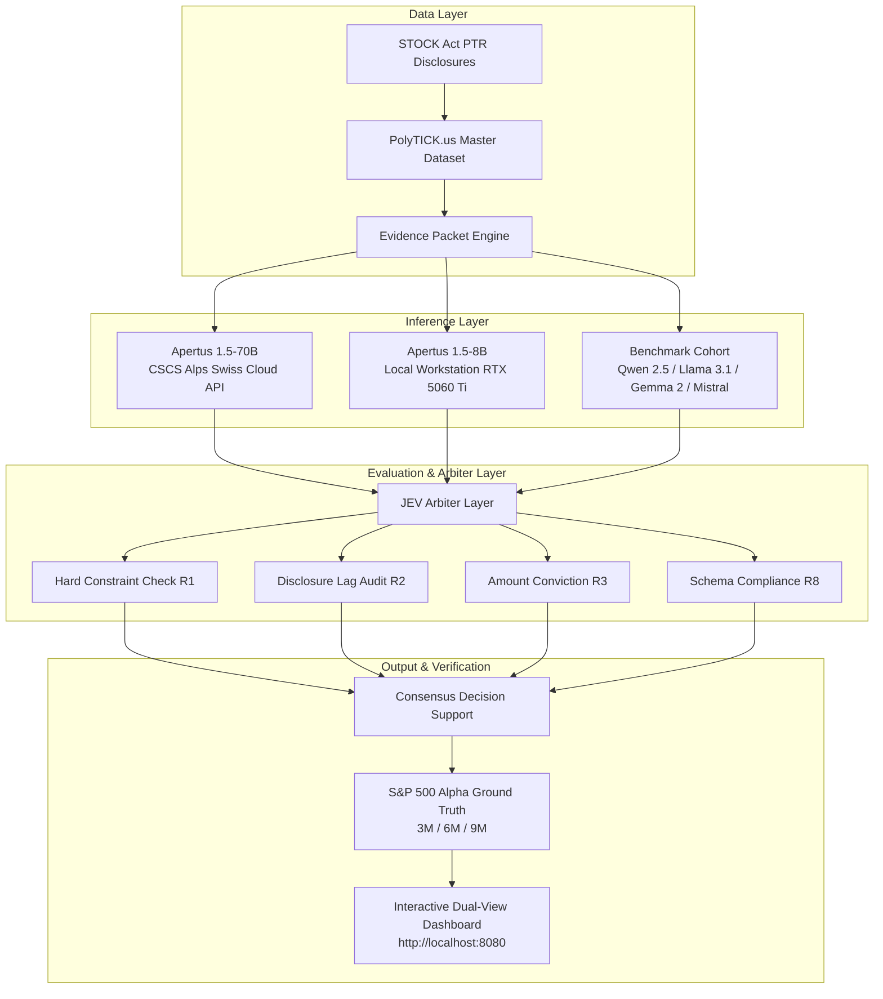

# System Architecture — Human-vs-System-in-the-Loop-Apertus

## Deployment Specifications

1. **CSCS Alps Supercomputer (Sovereign Swiss Cloud):**
   - Model: Apertus 1.5-70B (70 Billion Parameters)
   - Endpoint: `https://api.inference.cscs.ch/v1`
   - Data Sovereignty: Strictly governed under Swiss data residency laws.

2. **Local Edge / Workstation (On-Premise):**
   - Model: Apertus 1.5-8B (8 Billion Parameters)
   - Runtime: Ollama with CUDA 12.x on NVIDIA RTX 5060 Ti (16 GB VRAM)
   - Footprint: 5.2 GB in 4-bit GGUF quantization.

3. **Air-Gapped Offline Mode:**
   - Pre-cached historical ground-truth data in SQLite (`market_data_cache.db`).
   - Zero outbound HTTP network calls during evaluation runs.
